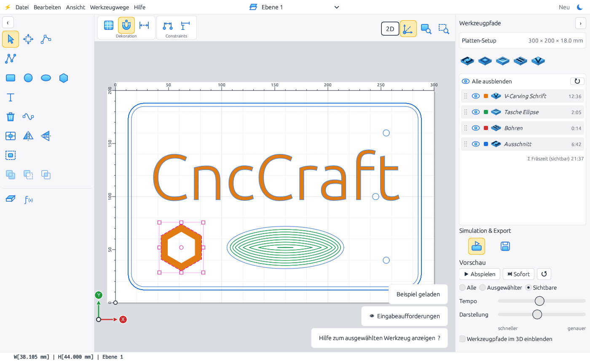

# CncCraft

### [Website &amp; documentation → freegroup.github.io/CncCraft](https://freegroup.github.io/CncCraft/)

**From idea to chips in minutes.** CncCraft is free, open-source CNC design software for makers: draw your part, add toolpaths, watch it mill in 3D, and send the G-Code to your machine — all in one fast, native app for macOS, Linux and Windows.

> **Clean-room implementation.** CncCraft is an independent reimplementation built from scratch by observing the *behaviour* of the original software. **No source code was taken from Vectric Spark, and the original application was never decompiled, disassembled, or reverse-engineered.** Every line of code here is original work. CncCraft is not affiliated with, endorsed by, or connected to Vectric Ltd. "Vectric" and "Spark" are trademarks of their respective owners.

<table>
<tr>
<td></td>
<td></td>
</tr>
</table>

## Why CncCraft

- **Design and machine in one place.** No juggling between a CAD tool, a CAM tool and a G-Code viewer.
- **See it before you cut it.** A real-time 3D simulation mills the material with the actual cutter, so mistakes show up on screen, not on your workpiece.
- **Parametric when you need it.** Type `Board_W - 2*Margin` into any size field and the whole design follows when a variable changes.
- **Fits your workflow.** Import DXF, export DXF and SVG, and generate G-Code for GRBL or your own post-processor.
- **Free, forever.** MIT-licensed, no account, no subscription, no cloud.

## Features

| | |
|---|---|
| **Draw** | Lines and polylines, Bézier splines, rectangles, circles, ellipses, polygons, TrueType text, DXF import |
| **Edit** | Node editing, move / scale / rotate / mirror, offset, union / subtract / intersect, align and centre, snapping, layers |
| **Parametric** | Named variables, formulas in every size field, dimensions, horizontal / vertical constraints |
| **Toolpaths** | Profile, pocket, V-carving, drilling and cut-out, with a tool library and machining-time estimates |
| **Simulation** | Real-time 3D milling preview (1/60× to 60×) with the cutter shown in place |
| **Output** | G-Code for GRBL and custom post-processors, DXF (R12 / R14) and SVG export |
| **Comfort** | Unlimited undo / redo, light and dark theme, English and German |

## Download

Get the latest version for your platform from the [**Releases page**](https://github.com/freegroup/CncCraft/releases/latest): macOS (Apple Silicon and Intel), Linux (`.tar.gz` / `.deb`) and Windows (installer).

## Build from source

Requires [Rust](https://rustup.rs) (stable):

```bash
cargo run --release
```

Releases are automated with [semantic-release](https://semantic-release.gitbook.io/): `fix:` commits cut a patch, `feat:` a minor and `feat!:` a major version. See [BUILD.md](BUILD.md) for packaging details.

---

Crafted with **CraftAnything** — more Craft Apps on the [freegroup GitHub profile](https://github.com/freegroup). Licensed under [MIT](LICENSE).
