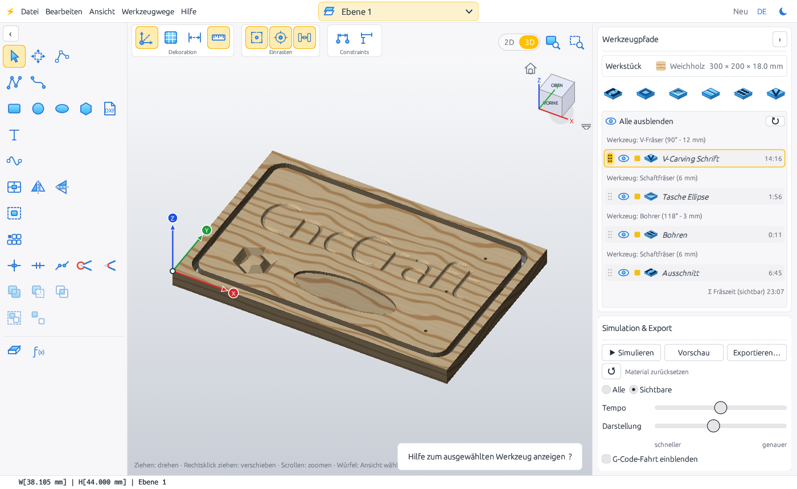
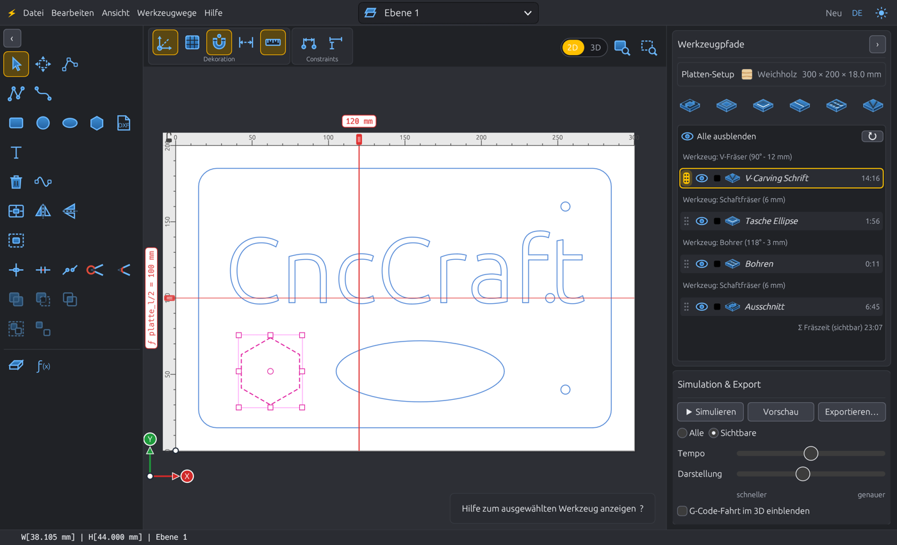

# CncCraft

### [Website &amp; documentation → freegroup.github.io/CncCraft](https://freegroup.github.io/CncCraft/)

**CNC design and milling software** — an open-source Rust/egui reimplementation of the core features of [Vectric Spark](https://www.vectric.com/products/spark), built for makers and CNC hobbyists.

Draw shapes, arrange toolpaths, preview the result in 3D, and export G-Code — all in a fast, native desktop app that runs on macOS, Linux, and Windows.

> **Clean-room implementation.** CncCraft is an independent reimplementation built from scratch by observing the *behaviour* of the original software. **No source code was taken from Vectric Spark, and the original application was never decompiled, disassembled, or reverse-engineered.** Every line of code here is original work. CncCraft is not affiliated with, endorsed by, or connected to Vectric Ltd. "Vectric" and "Spark" are trademarks of their respective owners.

---

## Screenshots

<table>
<tr>
<td><br/><em>2D design canvas with shapes and toolpaths</em></td>
<td><br/><em>3D workpiece preview with milled result</em></td>
</tr>
<tr>
<td colspan="2"><br/><em>Welcome screen — new project, open file, or load the example</em></td>
</tr>
</table>

---

## Features

| Category | What's included |
|---|---|
| **Shapes** | Rectangle, ellipse, polygon, star, freehand curves, text (TrueType) |
| **Editing** | Move, resize, rotate, node editing, offset, Boolean operations (union, subtract, intersect, exclude) |
| **Toolpaths** | Profile, pocket, V-carving, drilling — with time estimates |
| **Output** | G-Code export (mm or inch), 3D workpiece preview, toolpath animation |
| **Parametrics** | Formula-based dimensions (e.g. `Brett_B - 2*Rand`), named variables |
| **Usability** | Unlimited undo/redo, autosave, dark theme, zero-point indicator |

---

## Download

Grab the latest build for your platform from the [**Releases page**](https://github.com/freegroup/CncCraft/releases/latest).

| Platform | File |
|---|---|
| macOS (Apple Silicon) | `CncCraft-<version>-apple-silicon.dmg` |
| macOS (Intel) | `CncCraft-<version>-intel-mac.dmg` |
| Linux x86-64 | `CncCraft-<version>-linux-x86_64.tar.gz` |
| Windows x86-64 | `CncCraft-<version>-windows-x86_64-setup.exe` |

---

## Build from source

Requires [Rust](https://rustup.rs) (stable).

```bash
# Quick dev build
cargo run

# Build macOS packages locally and attach them to the matching release
./build_and_release.sh
```

## Releasing

Releases are fully automated with **[semantic-release](https://semantic-release.gitbook.io/)** driven by [Conventional Commits](https://www.conventionalcommits.org/). On every push to `main`, the version is derived from the commit messages:

| Commit prefix | Example | Version effect |
|---|---|---|
| `fix:` | `fix: correct G-Code feed rate` | patch (`0.1.1`) |
| `feat:` | `feat: add arc toolpaths` | minor (`0.2.0`) |
| `feat!:` / `BREAKING CHANGE:` | `feat!: new project format` | major (`1.0.0`) |
| `docs:`, `chore:`, `ci:`, `refactor:`, … | — | no release |

When a releasable commit lands, the GitHub Actions workflow (`.github/workflows/release.yml`) bumps `Cargo.toml`, updates `CHANGELOG.md`, tags the release, and **builds Windows + Linux** natively, attaching the packages automatically. **macOS packages** are built on a Mac with `./build_and_release.sh` and attached to the release — GitHub's hosted Apple Silicon runners aren't available on every account.

See [BUILD.md](BUILD.md) for the full build reference.

---

## Built with CraftAnything

CncCraft was crafted with **CraftAnything** — an approach to building polished, open-source creative tools for makers, one app at a time.

Discover more **Craft Apps** and projects on the [**freegroup GitHub profile**](https://github.com/freegroup).

---

## License

MIT — see [LICENSE](LICENSE).
